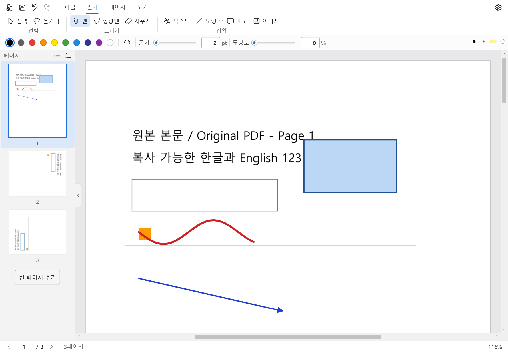

# DeotPDF (덧PDF)

**A lightweight PDF annotation and note-taking app for Windows, with a command-line tool (`deot`) that lets scripts and AI agents write on PDFs too.**

**윈도우용 가벼운 PDF 필기·주석 프로그램입니다. 스크립트나 AI 에이전트가 PDF에 필기할 수 있는 명령줄 도구(`deot`)도 함께 들어 있습니다.**

[English](#english) · [한국어](#한국어) · [Download / 다운로드](https://github.com/errorc0de404/DeotPDF/releases/latest) · [CLI guide](docs/cli.md) · [CLI 설명서](docs/cli.ko.md)



---

## English

DeotPDF is a free, open-source PDF note-taking app for Windows 10 and 11. You open a PDF (lecture slides, a paper, a manual) and write on it with a pen, highlighter, text boxes, shapes and images, using an ordinary mouse and keyboard. When you save, you get a normal PDF back. Other PDF viewers show your notes, and DeotPDF can still edit them the next time you open the file.

I built it because I wanted something between a heavy PDF editor and a plain viewer: it opens fast, doesn't need an account or an internet connection, and handles Korean text input properly.

The name comes from the Korean prefix 덧 (*deot*), "added on top". The original PDF stays as it is and your notes go on a layer above it.

### What you can do

**Writing and marking up**
- Pen and freehand highlighter with adjustable color, width and opacity
- Highlighter that snaps to the PDF's text: highlight, underline or strikeout exactly along the words
- Text boxes with per-character formatting (font, size, color, bold/italic/underline/strikeout, background, border) and full Korean IME support
- Straight lines and Bézier curves with arrowheads and dash styles; rectangles, ellipses, triangles and polygons
- Images (PNG, JPEG, BMP) from a file, drag and drop, or the clipboard
- Sticky notes
- Eraser that removes whole strokes or just the part you rub over. Holding the middle mouse button erases temporarily while you're using the pen.

**Selecting and editing**
- Click, Shift-click, rectangle or lasso selection; move, resize and rotate; lock items so they stay put
- Copy and paste between pages and between windows; full undo/redo

**Pages**
- New notes without a PDF (A4, A5, Letter or custom size; blank, grid or lined paper)
- Add, insert, delete, duplicate, rotate and reorder pages
- Shrink a page's content to make a writing margin, or enlarge the page itself and keep the content where it is
- Import pages from other PDFs, merge several PDFs into one, export page ranges as separate files

**Reading**
- Search the PDF text and your own text boxes (Ctrl+F)
- Table of contents, internal links, recent files, remembers the page and zoom you were at
- Light and dark themes, plus an inverted "dark page" mode for reading at night
- Korean and English interface

**Saving**
- Saves as a standard PDF. Your notes are written as regular PDF annotations, so Chrome, Edge, Firefox and other viewers show them.
- Re-open the file in DeotPDF and everything is still editable
- "Flatten" export merges the notes into the page for sharing or printing elsewhere. A flattened file can't be edited in DeotPDF anymore.
- Optional automatic backups and crash recovery

### Download and run

1. Grab a zip from the [Releases](https://github.com/errorc0de404/DeotPDF/releases/latest) page:
   - `DeotPDF-1.0.0-win-x64.zip` (small). Needs the [.NET 10 Desktop Runtime](https://dotnet.microsoft.com/download/dotnet/10.0) (x64). If it isn't installed, Windows will tell you when you start the app.
   - `DeotPDF-1.0.0-win-x64-portable.zip` (bigger, includes the runtime). Unzip and run, nothing else to install.
2. Unzip anywhere and run `DeotPDF.exe`.
3. Optional: to have DeotPDF show up under *Open with* for `.pdf` files, run this in the unzipped folder. It only touches your user account, needs no admin rights, and doesn't change your default PDF app.
   ```powershell
   powershell -NoProfile -ExecutionPolicy Bypass -File .\register-open-with.ps1
   # undo: add -Unregister
   ```

There's no installer yet. Settings and backups live in `%LOCALAPPDATA%\PdfNotes`.

### The `deot` command-line tool

The zip also contains `deot.exe`. It uses the same engine as the app, so whatever it writes looks and behaves exactly like something you drew yourself, and you can keep editing it in DeotPDF afterwards.

It was made with AI agents in mind: every command prints a single JSON object, errors come with stable codes, and `deot schema` describes every command's input and output. For example:

```powershell
deot info lecture.pdf                                   # pages, sizes, text layer, file hash
deot render lecture.pdf -p 3 -o p3.png                  # page to PNG, with page<->pixel matrices
deot find lecture.pdf --text "cell membrane" -p 3       # where a phrase is
deot add mark lecture.pdf -p 3 --find "cell membrane" -o out.pdf
deot add text lecture.pdf -p 3 --rect 500,60,200,0 --text "**Key point**: see fig. 2" -o out.pdf
deot apply lecture.pdf plan.json --dry-run --preview-dir preview   # many edits at once, all or nothing
```

The full guide is in [docs/cli.md](docs/cli.md).

### Build from source

You need Windows and the .NET SDK 10.0.401 (pinned in `global.json`).

```powershell
git clone https://github.com/errorc0de404/DeotPDF.git
cd DeotPDF
dotnet restore PdfNotes.slnx --locked-mode
dotnet build PdfNotes.slnx -c Release --no-restore
dotnet test PdfNotes.slnx -c Release --no-build
dotnet run --project src/PdfNotes.App -c Release -- path\to\file.pdf
```

To build the release folders:

```powershell
dotnet publish src/PdfNotes.App -c Release -r win-x64 --self-contained false -o out/DeotPDF
dotnet publish tools/PdfNotes.Cli -c Release -r win-x64 --self-contained false -o out/DeotPDF
```

(Use `--self-contained true` for the portable build.)

### Project layout

| Folder | What's in it |
|---|---|
| `src/PdfNotes.App` | The WPF app: windows, ribbon, canvas, tools |
| `src/PdfNotes.Editor` | Tool state, sessions, settings, search, backups (no WPF) |
| `src/PdfNotes.Core` | Document model, geometry, edit commands, undo/redo, serialization |
| `src/PdfNotes.Pdf` | Everything that talks to PDFium and PDFsharp: rendering, text extraction, saving, flatten |
| `src/PdfNotes.Text`, `src/PdfNotes.Text.Wpf` | Text layout shared by the screen, saved PDFs and the CLI |
| `tools/PdfNotes.Cli` | The `deot` command-line tool |
| `tests/PdfNotes.Tests` | Unit and integration tests |
| `docs/` | CLI guide, and [the format of the editing data stored in PDFs](docs/file-format.md) (Korean) |

Built with C#, WPF and .NET 10. PDF rendering and text extraction use [PDFium](https://pdfium.googlesource.com/pdfium/), reading and writing use [PDFsharp](https://github.com/empira/PDFsharp), and the eraser and lasso use [Clipper2](https://github.com/AngusJohnson/Clipper2).

### Known limitations

- Mouse and keyboard only for now. Pen pressure, palm rejection and touch gestures aren't there yet.
- PDFs that need a password to open, and digitally signed PDFs, aren't opened.
- No printing. Export a flattened PDF and print it from another viewer.
- If another app re-saves the PDF, DeotPDF may no longer be able to edit its notes (they stay visible).

### FAQ

**Is it free?** Yes. It's open source under GPL-3.0, with no ads, account or telemetry.

**Does it work offline?** Yes. Nothing is sent anywhere.

**Will my notes show up in other PDF readers?** Yes. They're saved as standard PDF annotations with their own appearance, so Chrome, Edge, Firefox and most other readers display them.

**Does it work on macOS or Linux?** Not yet. The core is plain .NET, but the app UI is WPF, which is Windows-only.

**Can an AI agent use it?** Yes, through `deot`. See [docs/cli.md](docs/cli.md).

---

## 한국어

덧PDF(DeotPDF)는 윈도우 10·11용 무료 오픈소스 PDF 필기 프로그램입니다. 강의 자료, 논문, 매뉴얼 같은 PDF를 열어서 마우스와 키보드로 펜, 형광펜, 텍스트 상자, 도형, 이미지를 얹을 수 있습니다. 저장하면 일반 PDF가 됩니다. 다른 PDF 뷰어에서도 필기가 그대로 보이고, 덧PDF로 다시 열면 이어서 고칠 수 있습니다.

무거운 PDF 편집기와 단순 뷰어 사이쯤 되는 프로그램이 필요해서 만들었습니다. 빨리 열리고, 계정이나 인터넷 연결이 필요 없고, 한글 입력이 제대로 되는 것을 목표로 했습니다.

원본 PDF는 건드리지 않고 그 위에 필기를 한 겹 덧붙인다고 해서 덧PDF입니다.

### 주요 기능

**필기와 표시**
- 펜, 자유 형광펜 (색·굵기·투명도 조절)
- PDF 글자에 맞춰 붙는 형광펜: 글자 위에서 그으면 형광·밑줄·취소선이 글자 줄에 딱 맞게 들어갑니다
- 텍스트 상자: 글자마다 글꼴·크기·색·굵게·기울임·밑줄·취소선을 따로 줄 수 있고, 배경과 테두리도 넣을 수 있습니다. 한글 입력도 문제없이 됩니다
- 직선, 곡선(화살표·점선 포함), 사각형, 타원, 삼각형, 다각형
- 이미지 넣기 (파일, 끌어다 놓기, 클립보드 붙여넣기)
- 스티키 메모
- 지우개: 획 통째로 지우기, 문지른 부분만 지우기. 펜을 쓰다가 마우스 가운데 버튼을 누르고 있으면 잠깐 지우개가 됩니다

**선택과 편집**
- 클릭, Shift 클릭, 사각형 선택, 올가미 선택. 옮기기, 크기 조절, 회전, 잠금
- 페이지 사이, 창 사이 복사·붙여넣기, 실행 취소·다시 실행

**페이지**
- PDF 없이 새 노트 만들기 (A4·A5·Letter·직접 입력, 백지·모눈·줄노트)
- 페이지 추가·삽입·삭제·복제·회전·순서 바꾸기
- 내용을 줄여서 필기할 여백 만들기, 또는 내용은 그대로 두고 페이지만 넓히기
- 다른 PDF에서 페이지 가져오기, 여러 PDF 합치기, 원하는 범위만 따로 PDF로 내보내기

**읽기**
- PDF 본문과 내가 쓴 텍스트 상자에서 검색 (Ctrl+F)
- 목차, PDF 안의 링크, 최근 문서, 마지막으로 보던 페이지·배율 기억
- 밝은 테마·어두운 테마, 밤에 읽기 좋은 페이지 색 반전 모드
- 한국어·영어 화면

**저장**
- 표준 PDF로 저장합니다. 필기는 일반 PDF 주석으로 들어가서 크롬, 엣지, 파이어폭스 같은 다른 뷰어에서도 보입니다
- 덧PDF로 다시 열면 전부 다시 고칠 수 있습니다
- '필기 합친 PDF(Flatten)'로 내보내면 필기가 페이지에 아예 합쳐져서, 공유하거나 다른 프로그램에서 인쇄하기 좋습니다. 대신 이렇게 내보낸 파일은 덧PDF에서 다시 고칠 수 없습니다
- 자동 백업, 비정상 종료 후 복구 (설정에서 켜고 끌 수 있습니다)

### 다운로드와 실행

1. [Releases](https://github.com/errorc0de404/DeotPDF/releases/latest) 페이지에서 zip을 받습니다.
   - `DeotPDF-1.0.0-win-x64.zip`: 용량이 작은 대신 [.NET 10 데스크톱 런타임](https://dotnet.microsoft.com/download/dotnet/10.0)(x64)이 필요합니다. 없으면 실행할 때 윈도우가 알려 줍니다.
   - `DeotPDF-1.0.0-win-x64-portable.zip`: 런타임이 들어 있어 용량이 큽니다. 압축만 풀면 바로 됩니다.
2. 아무 데나 압축을 풀고 `DeotPDF.exe`를 실행합니다.
3. (선택) PDF 파일 우클릭 › '연결 프로그램'에 덧PDF가 뜨게 하려면 압축 푼 폴더에서 아래를 실행합니다. 지금 사용자 계정에만 등록되고, 관리자 권한이 필요 없고, 기본 PDF 프로그램은 바꾸지 않습니다.
   ```powershell
   powershell -NoProfile -ExecutionPolicy Bypass -File .\register-open-with.ps1
   # 지우려면 뒤에 -Unregister
   ```

아직 설치 프로그램은 없습니다. 설정과 백업은 `%LOCALAPPDATA%\PdfNotes`에 저장됩니다.

### 명령줄 도구 `deot`

zip 안에 `deot.exe`도 들어 있습니다. 앱과 같은 엔진을 써서, `deot`로 넣은 필기도 앱에서 직접 그린 것과 똑같이 보이고 덧PDF에서 이어서 고칠 수 있습니다.

처음부터 AI 에이전트가 쓰기 좋게 만들었습니다. 모든 명령이 JSON 하나를 출력하고, 오류에는 정해진 코드가 붙고, `deot schema`로 명령마다 입력과 출력 형식을 확인할 수 있습니다. 예를 들면 이런 식입니다.

```powershell
deot info 강의.pdf                                       # 페이지 수·크기·글자 층·파일 해시
deot render 강의.pdf -p 3 -o p3.png                      # 페이지를 PNG로 (좌표 변환 행렬 포함)
deot find 강의.pdf --text "세포막" -p 3                  # 문구 위치 찾기
deot add mark 강의.pdf -p 3 --find "세포막" -o 결과.pdf  # 그 문구에 형광 표시
deot add text 강의.pdf -p 3 --rect 500,60,200,0 --text "**핵심**: 그림 2 참고" -o 결과.pdf
deot apply 강의.pdf plan.json --dry-run --preview-dir 미리보기   # 여러 작업을 한 번에, 하나라도 실패하면 아무것도 안 씀
```

자세한 내용은 [docs/cli.ko.md](docs/cli.ko.md)에 있습니다.

### 소스에서 빌드하기

윈도우와 .NET SDK 10.0.401(`global.json`에 고정)이 필요합니다.

```powershell
git clone https://github.com/errorc0de404/DeotPDF.git
cd DeotPDF
dotnet restore PdfNotes.slnx --locked-mode
dotnet build PdfNotes.slnx -c Release --no-restore
dotnet test PdfNotes.slnx -c Release --no-build
dotnet run --project src/PdfNotes.App -c Release -- 열고싶은파일.pdf
```

배포용 폴더는 이렇게 만듭니다. 포터블 버전은 `--self-contained true`로 바꾸면 됩니다.

```powershell
dotnet publish src/PdfNotes.App -c Release -r win-x64 --self-contained false -o out/DeotPDF
dotnet publish tools/PdfNotes.Cli -c Release -r win-x64 --self-contained false -o out/DeotPDF
```

### 아직 안 되는 것

- 지금은 마우스·키보드 전용입니다. 펜 필압, 손바닥 무시, 터치 제스처는 아직 없습니다.
- 열 때 암호가 필요한 PDF와 전자서명된 PDF는 열지 않습니다.
- 인쇄 기능이 없습니다. 필기 합친 PDF로 내보내서 다른 뷰어에서 인쇄해 주세요.
- 다른 프로그램에서 다시 저장한 PDF는 필기가 보이기는 하지만 덧PDF에서 다시 고치지 못할 수 있습니다.

### 자주 묻는 질문

**무료인가요?** 네. GPL-3.0 오픈소스이고 광고, 계정, 사용 통계 수집이 없습니다.

**인터넷 없이 되나요?** 됩니다. 밖으로 보내는 데이터도 없습니다.

**다른 PDF 뷰어에서도 필기가 보이나요?** 보입니다. 표준 PDF 주석으로 저장하기 때문에 크롬, 엣지, 파이어폭스 등 대부분의 뷰어에서 그대로 보입니다.

**맥이나 리눅스에서도 되나요?** 아직은 윈도우 전용입니다. 핵심 코드는 일반 .NET이지만 화면이 WPF라서 윈도우에서만 돌아갑니다.

**AI 에이전트가 PDF에 필기하게 할 수 있나요?** `deot`로 할 수 있습니다. [docs/cli.ko.md](docs/cli.ko.md)를 보세요.

---

## License / 라이선스

DeotPDF is licensed under the [GNU General Public License v3.0](LICENSE). Third-party components and their licenses are listed in [THIRD-PARTY-NOTICES.md](THIRD-PARTY-NOTICES.md).

덧PDF는 [GPL-3.0](LICENSE) 라이선스로 배포합니다. 함께 쓰는 라이브러리의 라이선스는 [THIRD-PARTY-NOTICES.md](THIRD-PARTY-NOTICES.md)에 있습니다.

Copyright © 2026 Eunseok Kim
