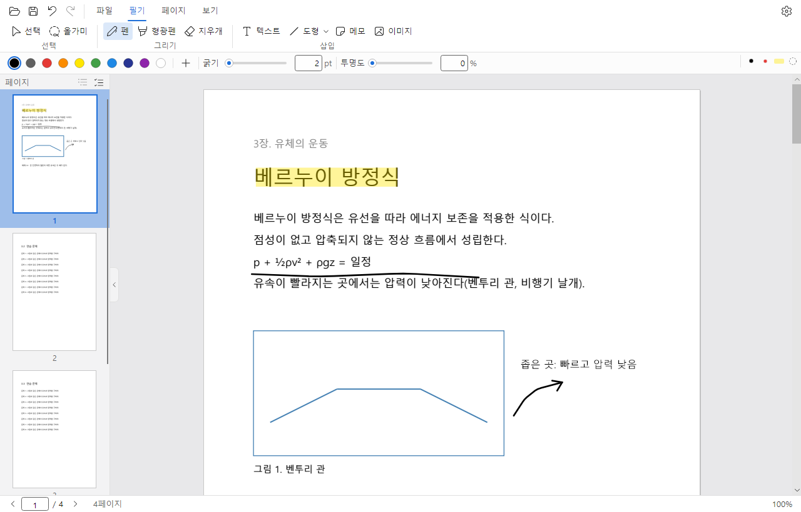

# DeotPDF (덧PDF)

**A lightweight PDF annotation and note-taking app for Windows, macOS and Linux, with a command-line tool (`deot`) that lets scripts and AI agents write on PDFs too.**

**윈도우·맥·리눅스에서 쓰는 가벼운 PDF 필기·주석 프로그램입니다. 스크립트나 AI 에이전트가 PDF에 필기할 수 있는 명령줄 도구(`deot`)도 함께 들어 있습니다.**

[English](#english) · [한국어](#한국어) · [Download / 다운로드](https://github.com/errorc0de404/DeotPDF/releases/latest) · [CLI guide](docs/cli.md) · [CLI 설명서](docs/cli.ko.md)



---

## English

DeotPDF is a free, open-source PDF note-taking app for Windows 10 and 11, macOS and Linux. You can add pen strokes, highlights, text boxes, shapes and images to a PDF with a mouse and keyboard or a tablet pen. Files are saved as normal PDFs: other viewers show the notes, and DeotPDF can edit them again.

I built it because I wanted something between a heavy PDF editor and a plain viewer: it opens fast, doesn't need an account or an internet connection, and handles Korean text input properly.

(The name comes from the Korean prefix 덧 (*deot*), "added on top": the notes go on a layer over the original PDF.)

### What you can do

**Writing and marking up**
- Pen and freehand highlighter (color, width, opacity). Tablet pen pressure, eraser end and palm rejection
- Text highlighter and an underline & strikeout tool, aligned to the PDF's text
- Text boxes: per-character font, size, color, bold, italic, underline and strikeout; background and border
- Straight lines and Bézier curves with arrowheads and dash styles; rectangles, ellipses, triangles and polygons. Hold the pen at the end of a stroke to turn it into a shape
- Tables: cells formatted like text boxes, rows and columns added from the right-click menu
- Images (PNG, JPEG, BMP) from a file, drag and drop, or the clipboard
- Sticky notes
- Eraser: whole strokes or an area

**Selecting and editing**
- Click, Shift-click, rectangle or lasso selection; move, resize and rotate; lock items so they stay put
- Two fingers zoom and scroll on a touch screen; drawing with a finger can be turned on in Settings
- Copy and paste between pages and between windows; full undo/redo

**Pages**
- New notes without a PDF (A4, A5, Letter or custom size; blank, grid or lined paper)
- Add, insert, delete, duplicate, rotate and reorder pages
- Shrink a page's content to make a writing margin, or enlarge the page itself and keep the content where it is
- Import pages from other PDFs, merge several PDFs into one, export page ranges as separate files

**Reading**
- Search the PDF text and your own text boxes
- Table of contents, internal links, recent files, remembers the page and zoom you were at
- Light and dark themes, inverted page colors
- Korean and English interface

**Saving**
- Saves as a standard PDF. Your notes are written as regular PDF annotations, so Chrome, Edge, Firefox and other viewers show them.
- Re-open the file in DeotPDF and everything is still editable
- "Flatten" export merges the notes into the page; a flattened file can't be edited in DeotPDF anymore
- Optional automatic backups and crash recovery

### Download and run

Grab the file for your system from the [Releases](https://github.com/errorc0de404/DeotPDF/releases/latest) page.

**Windows**
- `DeotPDF-<version>-win-x64.zip` (small) needs the [.NET 10 runtime](https://dotnet.microsoft.com/download/dotnet/10.0) (x64). If it isn't installed, Windows tells you when you start the app.
- `DeotPDF-<version>-win-x64-portable.zip` (bigger) has the runtime inside. Unzip and run.

Unzip anywhere and run `DeotPDF.exe`. To have DeotPDF show up under *Open with* for `.pdf` files, run this in the unzipped folder. It only touches your user account, needs no admin rights, and doesn't change your default PDF app.
```powershell
powershell -NoProfile -ExecutionPolicy Bypass -File .\register-open-with.ps1
# undo: add -Unregister
```
Windows may show a blue *Windows protected your PC* (SmartScreen) box the first time, because the app is new and not widely downloaded yet. Click **More info**, then **Run anyway**.

**macOS** (Apple silicon: `macos-arm64`, Intel: `macos-x64`)

Unzip and move `DeotPDF.app` to Applications. The app isn't signed with an Apple developer ID, so the first time, right-click it, choose **Open**, then **Open** again. After that it starts normally and shows up under *Open With* for PDF files.

**Linux** (`linux-x64.tar.gz`)

Unpack and run `./DeotPDF`. Korean text needs a Korean font such as Noto Sans CJK KR (`sudo apt install fonts-noto-cjk` on Debian and Ubuntu). `./register-open-with.sh` adds DeotPDF to *Open with* for your user.

There's no installer yet; the macOS and Linux packages include the .NET runtime. Settings and backups live in `%LOCALAPPDATA%\PdfNotes` on Windows, `~/Library/Application Support/PdfNotes` on macOS and `~/.config/PdfNotes` on Linux. To check a download, compare its SHA256 with the one on the release page.

### The `deot` command-line tool

Every package also contains `deot` (`deot.exe` on Windows, `DeotPDF.app/Contents/MacOS/deot` on macOS). It uses the same engine as the app, so whatever it writes looks and behaves exactly like something you drew yourself, and you can keep editing it in DeotPDF afterwards.

Every command is meant for AI agents: it prints a single JSON object, errors come with stable codes, and `deot schema` describes each command's input and output. For example:

```powershell
deot info lecture.pdf                                   # pages, sizes, text layer, file hash
deot render lecture.pdf -p 3 -o p3.png                  # page to PNG, with page<->pixel matrices
deot find lecture.pdf --text "cell membrane" -p 3       # where a phrase is
deot add mark lecture.pdf -p 3 --find "cell membrane" -o out.pdf
deot add text lecture.pdf -p 3 --rect 500,60,200,0 --text "**Key point**: see fig. 2" -o out.pdf
deot apply lecture.pdf plan.json --dry-run --preview-dir preview   # many edits at once, all or nothing
```

It also runs as an MCP server for Claude Desktop, Claude Code and other MCP clients. It only touches files in the folders you allow:

```powershell
claude mcp add deot -- C:\Tools\DeotPDF\deot.exe mcp --root C:\Users\me\Lectures
```

A Claude Desktop extension (`.mcpb`) is on the Releases page. See the [CLI guide](docs/cli.md#mcp-server).

**Working with an AI assistant side by side (experimental).** Turn on Settings › Notes › `AI tool access`, and an assistant that has `deot` (through MCP or the command line) can read the document you have open and write notes into it while you study. DeotPDF asks before letting it in, and you choose between read only, writing its own notes, or full editing. What the assistant writes is kept apart as AI notes: you can hide, highlight or erase them from the `AI` tab, or keep the ones you like as your own. Only programs on the same PC can connect.

The full guide is in [docs/cli.md](docs/cli.md).

### Build from source

You need the .NET SDK 10.0.401 (pinned in `global.json`) on Windows, macOS or Linux.

```powershell
git clone https://github.com/errorc0de404/DeotPDF.git
cd DeotPDF
dotnet build PdfNotes.slnx -c Release
dotnet test PdfNotes.slnx -c Release --no-build
dotnet run --project src/PdfNotes.Desktop -c Release -- path/to/file.pdf
```

The lock files cover Windows, macOS and Linux, so `dotnet restore --locked-mode` works on each. The Android app is a separate solution (`PdfNotes.Android.slnx`, needs the Android workload); it is not part of the releases yet. [CONTRIBUTING.md](CONTRIBUTING.md) has the layout of the code and the rules it follows.

To build the release packages for one system (they land in `artifacts/release`), use PowerShell:

```powershell
pwsh tools/package-release.ps1 -Rid win-x64     # or linux-x64, osx-arm64, osx-x64
```

Releases are built the same way by GitHub Actions (`.github/workflows/release.yml`).

### Project layout

| Folder | What's in it |
|---|---|
| `src/PdfNotes.Desktop` | The desktop app: its window and what it takes from the system |
| `src/PdfNotes.UI` | The view (Avalonia) the desktop and Android apps share: ribbon, canvas, dialogs |
| `src/PdfNotes.ViewModels` | What the windows show and do, without a UI library |
| `src/PdfNotes.Editor` | Tools, sessions, settings, search, backups |
| `src/PdfNotes.Core` | Document model, geometry, edit commands, undo/redo, serialization |
| `src/PdfNotes.Pdf` | Everything that talks to PDFium and PDFsharp: rendering, text extraction, saving, flatten |
| `src/PdfNotes.Text`, `src/PdfNotes.Text.Skia` | Text layout (Skia and HarfBuzz) shared by the screen, saved PDFs and the CLI |
| `src/PdfNotes.TextEditor`, `src/PdfNotes.TextEditor.Avalonia` | The text box editor and its IME handling |
| `src/PdfNotes.Render.Skia` | Drawing annotations on screen |
| `src/PdfNotes.Commands`, `src/PdfNotes.Cli` | The `deot` commands, and the command-line tool and MCP server that run them |
| `src/PdfNotes.Android` | The Android tablet app (in progress, not in the releases yet) |
| `tests/` | Unit and integration tests, and the app's window tests (Avalonia.Headless) |
| `docs/` | CLI guide, and [the format of the editing data stored in PDFs](docs/file-format.md) (Korean) |

Built with C#, .NET 10 and [Avalonia](https://avaloniaui.net). Text and drawing use [SkiaSharp](https://github.com/mono/SkiaSharp) and HarfBuzz, PDF rendering and text extraction use [PDFium](https://pdfium.googlesource.com/pdfium/), reading and writing use [PDFsharp](https://github.com/empira/PDFsharp), and the eraser and lasso use [Clipper2](https://github.com/AngusJohnson/Clipper2).

### Known limitations

- The macOS and Linux versions pass the automated tests on both systems, but I haven't used them on a real Mac or Linux PC yet. Korean input on Linux depends on your input method setup. Reports are welcome.
- PDFs that need a password to open, and digitally signed PDFs, aren't opened.
- No printing. Export a flattened PDF and print it from another viewer.
- If another app re-saves the PDF, DeotPDF may no longer be able to edit its notes (they stay visible).

### FAQ

**Is it free?** Yes. It's open source under GPL-3.0, with no ads, account or telemetry. The internet is used only for the update check (once a day at most, can be turned off in Settings).

**Will my notes show up in other PDF readers?** Yes. They're saved as standard PDF annotations with their own appearance, so Chrome, Edge, Firefox and most other readers display them.

**Does it work on macOS or Linux?** Yes, since 1.2.1.

**Can an AI agent use it?** Yes, through `deot`. See [docs/cli.md](docs/cli.md).

---

## 한국어

덧PDF(DeotPDF)는 윈도우 10·11, 맥, 리눅스에서 쓰는 무료 오픈소스 PDF 필기 프로그램입니다. PDF 파일에 마우스·키보드나 태블릿 펜으로 펜, 형광펜, 텍스트 상자, 도형, 이미지를 얹을 수 있습니다. 저장 형식은 일반 PDF이고, 다른 뷰어에서도 필기가 그대로 보이고, 덧PDF로 다시 열면 이어서 고칠 수 있습니다.

무거운 PDF 편집기와 단순 뷰어 사이쯤 되는 프로그램이 필요해서 만들었습니다. 빨리 열리고, 계정이나 인터넷 연결이 필요 없고, 한글 입력이 제대로 되는 것을 목표로 했습니다.

(원본 PDF는 건드리지 않고 그 위에 필기를 한 겹 덧붙인다고 해서 덧PDF입니다.)

### 주요 기능

**필기와 표시**
- 펜, 자유 형광펜 (색·굵기·투명도 조절). 태블릿 펜 필압 인식, 펜 뒤쪽 지우개, 손바닥 무시 지원
- PDF 글자에 맞춰 붙는 형광펜과 밑줄·취소선 도구
- 텍스트 상자: 글자마다 글꼴·크기·색·굵게·기울임·밑줄·취소선 적용 가능, 배경과 테두리
- 직선, 곡선(화살표·점선 포함), 사각형, 타원, 삼각형, 다각형. 펜 획 끝에서 멈추면 도형으로 바뀜
- 표: 칸 글자는 텍스트 상자와 같은 서식, 우클릭으로 행·열 넣기·삭제
- 이미지 넣기 (파일, 끌어다 놓기, 클립보드 붙여넣기)
- 스티키 메모
- 지우개: 획 통째로 지우기, 영역 지우기

**선택과 편집**
- 클릭, Shift 클릭, 사각형 선택, 올가미 선택. 옮기기, 크기 조절, 회전, 잠금
- 터치 화면에서는 두 손가락으로 확대하고 움직입니다. 손가락으로 그리기는 설정에서 켤 수 있습니다
- 페이지 사이, 창 사이 복사·붙여넣기, 실행 취소·다시 실행

**페이지**
- PDF 없이 새 노트 만들기 (A4·A5·Letter·직접 입력, 백지·모눈·줄노트)
- 페이지 추가·삽입·삭제·복제·회전·순서 바꾸기
- 내용을 줄여서 필기할 여백 만들기, 또는 내용은 그대로 두고 페이지만 넓히기
- 다른 PDF에서 페이지 가져오기, 여러 PDF 합치기, 원하는 범위만 따로 PDF로 내보내기

**읽기**
- PDF 본문과 내가 쓴 텍스트 상자에서 검색
- 목차, PDF 안의 링크, 최근 문서, 마지막으로 보던 페이지·배율 기억
- 밝은 테마·어두운 테마, 페이지 색 반전 모드
- 한국어·영어 화면

**저장**
- 표준 PDF로 저장합니다. 필기는 일반 PDF 주석으로 들어가서 크롬, 엣지, 파이어폭스 같은 다른 뷰어에서도 보입니다
- 덧PDF로 다시 열면 전부 다시 고칠 수 있습니다
- '필기 합친 PDF(Flatten)'로 내보내면 필기가 페이지에 아예 합쳐지며, 이 경우 덧PDF에서 다시 고칠 수 없습니다
- 자동 백업, 비정상 종료 후 복구 (설정에서 켜고 끌 수 있습니다)

### 다운로드와 실행

[Releases](https://github.com/errorc0de404/DeotPDF/releases/latest) 페이지에서 쓰는 시스템에 맞는 파일을 받습니다.

**윈도우**
- `DeotPDF-<버전>-win-x64.zip`: 용량이 작은 대신 [.NET 10 런타임](https://dotnet.microsoft.com/download/dotnet/10.0)(x64)이 필요합니다. 없으면 실행할 때 윈도우가 알려 줍니다.
- `DeotPDF-<버전>-win-x64-portable.zip`: 런타임이 들어 있어 용량이 큽니다. 압축만 풀면 바로 됩니다.

아무 데나 압축을 풀고 `DeotPDF.exe`를 실행합니다. PDF 파일 우클릭 › '연결 프로그램'에 덧PDF가 뜨게 하려면 압축 푼 폴더에서 아래를 실행합니다. 지금 사용자 계정에만 등록되고, 관리자 권한이 필요 없고, 기본 PDF 프로그램은 바꾸지 않습니다.
```powershell
powershell -NoProfile -ExecutionPolicy Bypass -File .\register-open-with.ps1
# 지우려면 뒤에 -Unregister
```
처음 실행할 때 파란색 'Windows의 PC 보호'(SmartScreen) 창이 뜰 수 있습니다. 새로 나온 프로그램이라 아직 받은 사람이 적어서 그렇습니다. '추가 정보'를 누른 다음 '실행'을 누르면 됩니다.

**맥** (Apple 실리콘은 `macos-arm64`, 인텔은 `macos-x64`)

압축을 풀고 `DeotPDF.app`을 '응용 프로그램' 폴더로 옮깁니다. Apple 개발자 서명이 없어서 처음 한 번은 앱을 우클릭해 '열기'를 고르고, 한 번 더 '열기'를 눌러야 합니다. 그다음부터는 그냥 열리고, Finder의 PDF '다음으로 열기' 목록에도 나옵니다.

**리눅스** (`linux-x64.tar.gz`)

압축을 풀고 `./DeotPDF`를 실행합니다. 한글을 보려면 Noto Sans CJK KR 같은 한글 글꼴이 있어야 합니다(Debian·Ubuntu는 `sudo apt install fonts-noto-cjk`). `./register-open-with.sh`를 실행하면 '다른 프로그램으로 열기'에 덧PDF가 들어갑니다.

아직 설치 프로그램은 없습니다. 맥·리눅스 판에는 .NET 런타임이 들어 있습니다. 설정과 백업은 윈도우 `%LOCALAPPDATA%\PdfNotes`, 맥 `~/Library/Application Support/PdfNotes`, 리눅스 `~/.config/PdfNotes`에 저장됩니다. 받은 파일이 맞는지 확인하고 싶으면 SHA256을 릴리스 페이지에 적힌 값과 비교해 보세요.

### 명령줄 도구 `deot`

모든 패키지에 `deot`도 들어 있습니다(윈도우는 `deot.exe`, 맥은 `DeotPDF.app/Contents/MacOS/deot`). 앱과 같은 엔진을 써서, `deot`로 넣은 필기도 앱에서 직접 그린 것과 똑같이 보이고 덧PDF에서 이어서 고칠 수 있습니다.

모든 명령은 AI 에이전트의 사용을 염두에 두었습니다. JSON 하나를 출력하고, 오류에는 정해진 코드가 붙고, `deot schema`로 명령마다 입력과 출력 형식을 확인할 수 있습니다. 예를 들면 이런 식입니다.

```powershell
deot info 강의.pdf                                       # 페이지 수·크기·글자 층·파일 해시
deot render 강의.pdf -p 3 -o p3.png                      # 페이지를 PNG로 (좌표 변환 행렬 포함)
deot find 강의.pdf --text "세포막" -p 3                  # 문구 위치 찾기
deot add mark 강의.pdf -p 3 --find "세포막" -o 결과.pdf  # 그 문구에 형광 표시
deot add text 강의.pdf -p 3 --rect 500,60,200,0 --text "**핵심**: 그림 2 참고" -o 결과.pdf
deot apply 강의.pdf plan.json --dry-run --preview-dir 미리보기   # 여러 작업을 한 번에, 하나라도 실패하면 아무것도 안 씀
```

MCP 서버도 지원하며 Claude Desktop, Claude Code 같은 MCP 클라이언트에서 도구로 바로 쓸 수 있습니다. 허락한 폴더 안의 파일만 다룹니다.

```powershell
claude mcp add deot -- C:\Tools\DeotPDF\deot.exe mcp --root C:\Users\me\Lectures
```

Claude Desktop용 확장 파일(`.mcpb`)은 Releases 페이지에 있습니다. [CLI 설명서](docs/cli.ko.md#mcp-서버) 참고.

**AI와 나란히 놓고 쓰기 (실험 기능).** 설정 › 필기 › `AI 도구 연결`을 켜면, `deot`를 쓸 수 있는 AI(MCP나 명령줄)가 지금 열어 둔 문서를 읽고 거기에 바로 필기를 적어 줍니다. 공부하다가 "이 부분 설명 좀 적어 줘" 하는 식으로 쓸 수 있습니다. 연결할 때마다 덧PDF가 먼저 물어보고, 읽기만 / AI 필기 쓰기 / 전체 편집 중에서 고릅니다. AI가 쓴 것은 AI 필기로 따로 구분돼서 `AI` 탭에서 한꺼번에 숨기거나 강조하거나 지울 수 있고, 마음에 드는 것만 내 필기로 남길 수도 있습니다. 같은 PC의 프로그램만 연결할 수 있습니다.

자세한 내용은 [docs/cli.ko.md](docs/cli.ko.md)에 있습니다.

### 소스에서 빌드하기

.NET SDK 10.0.401(`global.json`에 고정)이 있으면 윈도우·맥·리눅스 어디서든 됩니다.

```powershell
git clone https://github.com/errorc0de404/DeotPDF.git
cd DeotPDF
dotnet build PdfNotes.slnx -c Release
dotnet test PdfNotes.slnx -c Release --no-build
dotnet run --project src/PdfNotes.Desktop -c Release -- 열고싶은파일.pdf
```

잠금 파일에 윈도우·맥·리눅스가 모두 들어 있어서 어느 OS에서든 `dotnet restore --locked-mode`가 됩니다. 안드로이드 앱은 솔루션이 따로 있고(`PdfNotes.Android.slnx`, 안드로이드 워크로드 필요), 아직 배포 파일에는 없습니다. 코드 구조와 지켜야 할 규칙은 [CONTRIBUTING.md](CONTRIBUTING.md)에 적어 두었습니다.

배포용 패키지는 PowerShell로 만듭니다(`artifacts/release`에 생김).

```powershell
pwsh tools/package-release.ps1 -Rid win-x64     # linux-x64, osx-arm64, osx-x64도 됨
```

### 아직 안 되는 것

- 맥·리눅스 판은 두 시스템에서 자동 테스트를 통과했지만, 실제 맥이나 리눅스 PC에서는 아직 써 보지 못했습니다. 리눅스의 한글 입력은 입력기 설정에 따라 다를 수 있습니다. 문제가 있으면 알려 주세요.
- 열 때 암호가 필요한 PDF와 전자서명된 PDF는 열지 않습니다.
- 인쇄 기능이 없습니다. 필기 합친 PDF로 내보내서 다른 뷰어에서 인쇄해 주세요.
- 다른 프로그램에서 다시 저장한 PDF는 필기가 보이기는 하지만 덧PDF에서 다시 고치지 못할 수 있습니다.

### 자주 묻는 질문

**무료인가요?** 네. GPL-3.0 오픈소스이고 광고, 계정, 사용 통계 수집이 없습니다. 인터넷은 업데이트 확인(하루 한 번, 설정에서 끌 수 있음)에만 씁니다.

**다른 PDF 뷰어에서도 필기가 보이나요?** 보입니다. 표준 PDF 주석으로 저장하기 때문에 크롬, 엣지, 파이어폭스 등 대부분의 뷰어에서 그대로 보입니다.

**맥이나 리눅스에서도 되나요?** 네. 1.2.1부터 지원됩니다.

**AI 에이전트가 PDF에 필기하게 할 수 있나요?** `deot`로 할 수 있습니다. [docs/cli.ko.md](docs/cli.ko.md)를 보세요.

---

## License / 라이선스

DeotPDF is licensed under the [GNU General Public License v3.0](LICENSE). Third-party components and their licenses are listed in [THIRD-PARTY-NOTICES.md](THIRD-PARTY-NOTICES.md).

덧PDF는 [GPL-3.0](LICENSE) 라이선스로 배포합니다. 함께 쓰는 라이브러리의 라이선스는 [THIRD-PARTY-NOTICES.md](THIRD-PARTY-NOTICES.md)에 있습니다.

Copyright © 2026 Eunseok Kim
